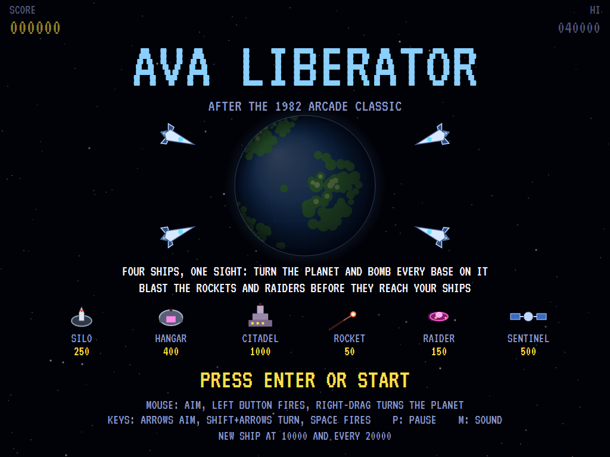
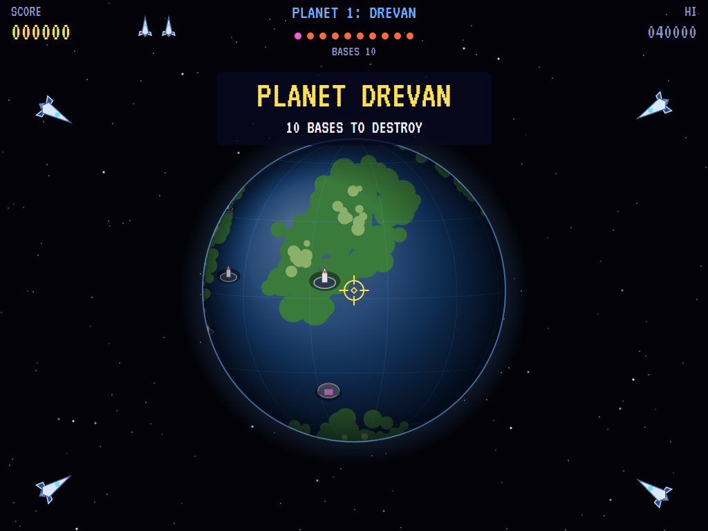
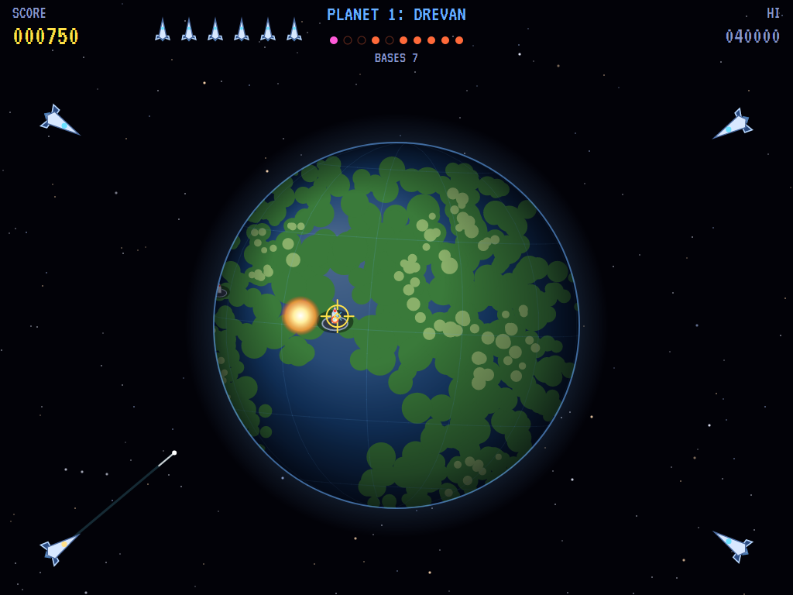
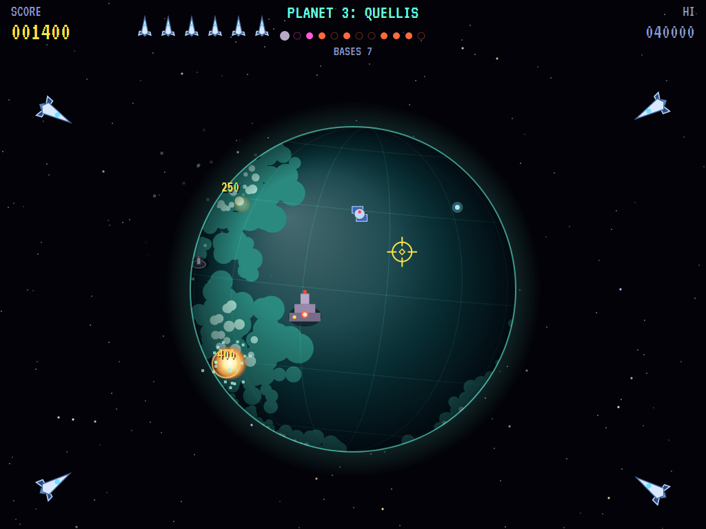
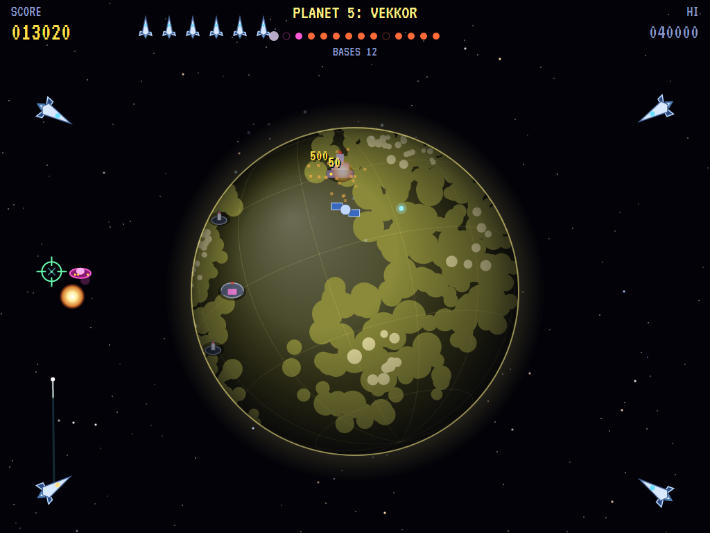
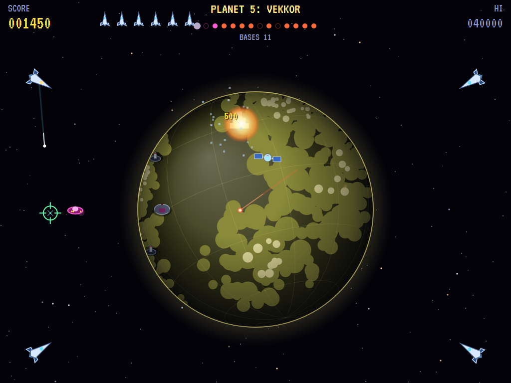
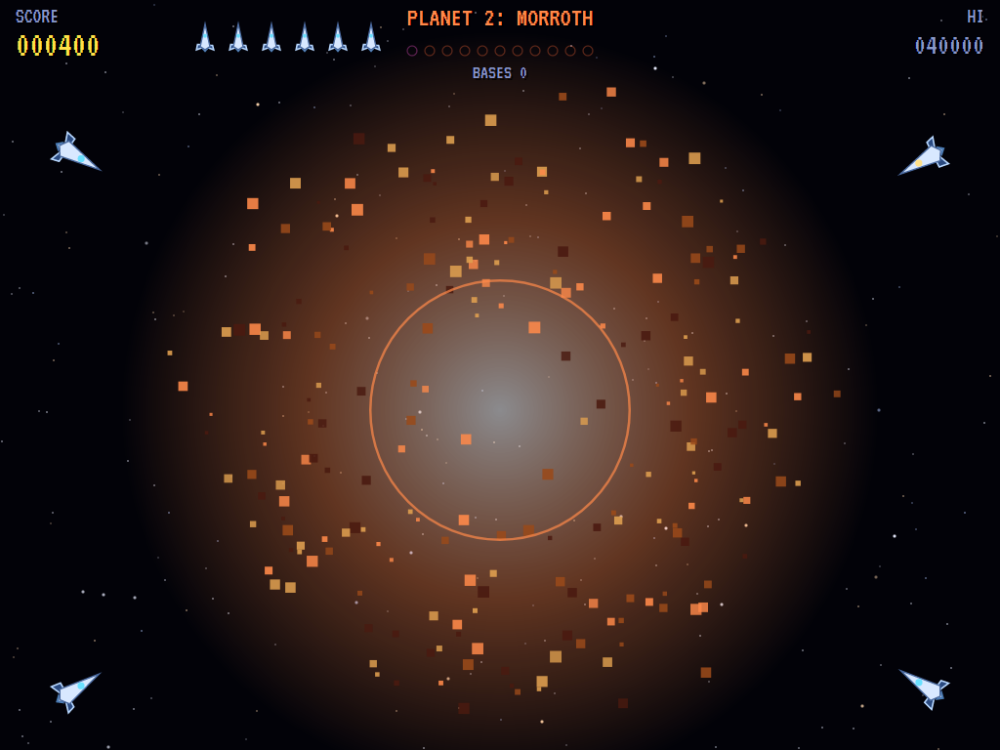
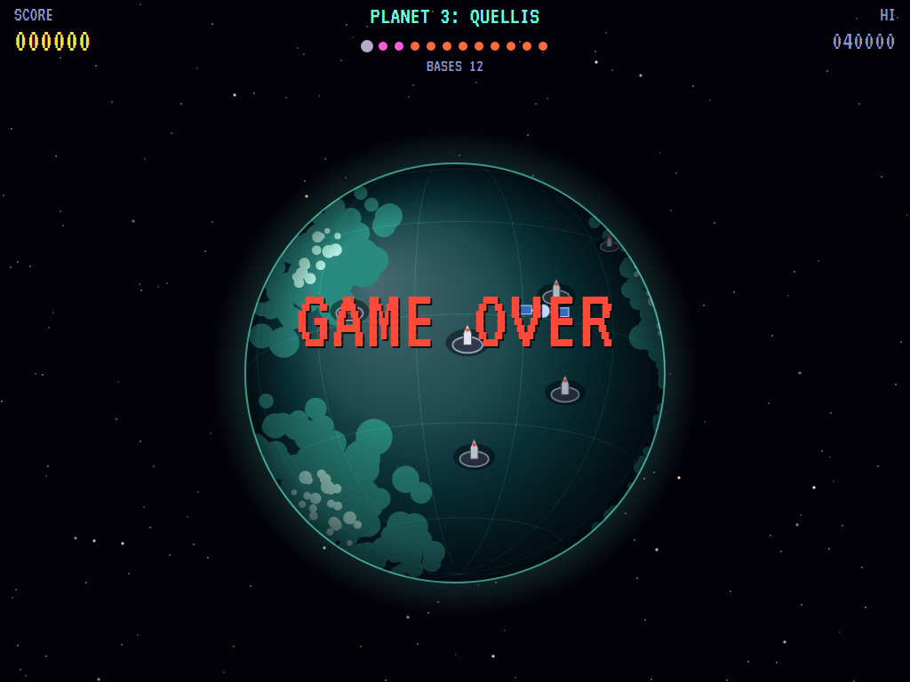
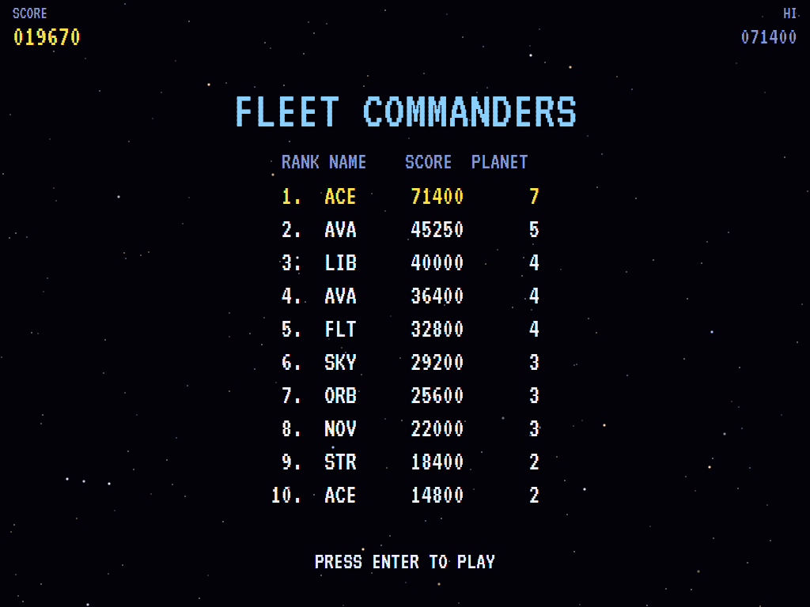

# AVA Liberator

[](https://github.com/Harlock123/AVALiberator/actions/workflows/build.yml)

A planet-bombing shooter in the style of Atari's 1982 arcade game **Liberator**, built with .NET 10 and
Avalonia UI. Your fleet of four ships holds the corners of the screen around an occupied world that
turns in space. Every missile goes where your one sight is: turn the planet to bring its bases round,
bomb them as they come, and blow up the rockets and raiders they send up before they reach your ships.
Destroy the last base and the planet breaks apart. Then on to the next one.

## Features

- **The planet**: a turning globe with seas, continents, mountains and a haze of air, lit from one side.
  - **It turns on its own**, a different way on each planet, and you can push it faster, slow it, or turn
    it any way you like to bring a base round.
  - **Eight worlds**, each with its own colours: Drevan, Morroth, Quellis, Sarnek, Vekkor, Thulon, Ashgar
    and Zemra. After the eighth they come round again, harder.
- **The fleet**: four ships, one at each corner, and one sight between them.
  - **Missiles** fly from whichever ship is nearest the sight and ready. Each ship can have two up at once,
    the fleet six.
  - **Blasts** grow and fade where the missile stops. One on the planet's face sticks to it and turns with
    it, and destroys any base under it. One in space destroys whatever flies into it.
  - **Reserves**: two more ships wait in reserve. When one of the four is lost, a replacement flies in. The
    game ends when the last ship goes. A new ship comes at 10000 points and every 20000 after.
- **The bases**: only the ones facing you fight back.
  - **Silos** (250) send up rockets, each straight at one of your ships.
  - **Hangars** (400) launch raiders (150): saucers that rise off the planet, then swing round to dive on a ship.
  - **Citadels** (1000), from the third planet, take three hits and fire salvos of rockets.
- **Sentinels** (500): satellites in orbit, from the second planet on. While they're behind the planet
  you can't see or hit them. In front, they fire fast pellets at the nearest ship.
- **Liberation**: destroy the last base and the planet shakes, cracks open and blows apart, for a bonus of
  1000 per planet plus 500 for every ship still in the fight.
- **Each planet is harder**: more bases, faster rockets launched more often, more hangars and sentinels.
- **The attract mode** plays itself: a computer player intercepts whatever threatens a ship soonest, and
  bombs the base facing it most squarely, leading it as the planet turns.
- **The sounds** are all synthesised: missiles, blasts, the enemy's launches, a planet breaking up, a
  battle drone, and the title march.

## Screenshots

| The title | Closing on a planet | The fight for Drevan |
|:---------:|:-------------------:|:--------------------:|
|  |  |  |
| The fleet, and the enemy. | Ten bases to destroy. | A missile on its way, a blast going up. |

| A citadel | Raiders | A sentinel |
|:---------:|:-------:|:----------:|
|  |  |  |
| Three hits to bring it down. | A saucer swinging in on a ship. | Blasted as it comes round. |

| Liberated | Game over | The high scores |
|:---------:|:---------:|:---------------:|
|  |  |  |
| The last base gone, the planet goes. | The fleet is lost. | The fleet commanders. |

The screenshots are made by the tests, which play the game in a real (headless) window; see
[Tests](#tests).

## Download and run

Ready-to-run builds for Windows, macOS and Linux, on both Intel/AMD and ARM, are on the
[Releases page](https://github.com/Harlock123/AVALiberator/releases/tag/latest). **Latest build** is
rebuilt on every push to `main`. Each download is one self-contained executable: no .NET install is
needed.

| Platform | Archive |
|---|---|
| Windows | `AVALiberator-win-x64.zip`, `AVALiberator-win-x86.zip`, `AVALiberator-win-arm64.zip` |
| macOS | `AVALiberator-osx-arm64.tar.gz` (Apple silicon), `AVALiberator-osx-x64.tar.gz` (Intel) |
| Linux | `AVALiberator-linux-x64.tar.gz`, `AVALiberator-linux-arm64.tar.gz`, `AVALiberator-linux-arm.tar.gz` |

```bash
tar -xzf AVALiberator-linux-x64.tar.gz     # or linux-arm64, linux-arm, osx-arm64, osx-x64
./AVALiberator
```

On Windows, unzip and run `AVALiberator.exe`. On macOS, if Gatekeeper refuses to open it, run
`xattr -d com.apple.quarantine AVALiberator` once. Run with `--no-audio` for silence.

**Sound** comes through OpenAL Soft, built in for every platform. In a virtual machine the game
detects it and uses a larger audio buffer, so the sound doesn't break up.

**Gamepads** use SDL2, which is bundled for Windows, macOS and Intel/AMD Linux. ARM Linux builds need it
installed; without it the keyboard still works:

```bash
sudo apt install libsdl2-dev            # Debian / Ubuntu / Raspberry Pi OS
sudo pacman -S --needed sdl2-compat     # Arch / Omarchy
```

## Controls

| Input | Action |
|-------|--------|
| **Enter** | Start |
| **Arrow keys** / **W A S D** | Walk (diagonals too) |
| **Space** / **Z** / **X** / **Ctrl** | Shoot an arrow, the way you last walked (in a room) |
| **P** / **Esc** | Pause (Esc again to quit) |
| **M** | Mute |
| **Ctrl+S** / **Cmd+S** | Save a screenshot to the Pictures folder |

**Gamepad**: left stick or D-pad to walk, **A**, **B**, **X** or the right trigger to shoot, **Start** to
start and pause, **Back** (while paused) to quit.

**Entering initials**: type letters, or dial with **Up**/**Down** and accept with **Space**; **Left** /
**Backspace** go back; **Enter** finishes.

## Controls

The original had a trackball; here the mouse is the trackball.

| Action | Mouse | Keyboard | Gamepad |
|---|---|---|---|
| Aim the sight | Move | Arrows / WASD | Left stick / D-pad |
| Fire | Left button | Space, Z, X or Ctrl | A, B, X or right trigger |
| Turn the planet | Drag with the right button | Shift + arrows | Right stick |
| Start | | Enter | Start |
| Pause | | P or Esc | Start |
| Sound on/off | | M | |
| Screenshot | | Ctrl+S (to your Pictures folder) | |

On the high-score table, type your initials, or use up/down and Space, then Enter.

## Tests

```bash
dotnet test AVALiberator.slnx
```

The engine has no UI and runs in fixed 60 Hz steps, so it plays the same at any frame rate, and a seed
always plays the same game. The tests check:

- **The sight and the planet:**
  - the sight on the keys and the mouse, kept on screen
  - turning the planet each way, and its own turning
  - points on the planet's face and the screen matching up
- **The fleet's missiles:**
  - from the nearest ship to the sight, two per ship and six in all
  - blasts that grow and fade, and stick to the planet
- **The bases:**
  - silos and citadels destroyed (and a near miss not)
  - silos firing only while they face the fleet
  - hangars sending up raiders that dive on a ship
- **The enemy in the sky:**
  - rockets and raiders blown up
  - a ship lost and its replacement flying in
  - the last ship ending the game
  - sentinels out of reach behind the planet
- **Planets:**
  - more bases and enemies on each
  - the planet breaking up for its bonus, and on to the next
  - new ships
- **The machine:** the attract cycle, the computer player liberating the first planet, the same game from the same seed, and pausing

The screenshot tests draw the real screen in a headless window. To refresh the README's pictures:

```bash
LIBERATOR_SHOTS=$PWD/Images dotnet test tests/AVALiberator.Tests --filter ScreenshotTests
```

To see how the computer player gets on, planet by planet (for tuning):

```bash
LIBERATOR_PROBE=1 dotnet test tests/AVALiberator.Tests --filter PilotProbe --logger "console;verbosity=detailed"
```

## Building

```bash
dotnet build AVALiberator.slnx
dotnet run --project src/AVALiberator
```

Needs the .NET 10 SDK. The sounds are made by `tools/make_sounds.py` (standard-library Python):
`python3 tools/make_sounds.py` rewrites `src/AVALiberator/Sounds`.

## Project structure

```
AVALiberator/
├── AVALiberator.slnx
├── src/AVALiberator/
│   ├── Engine/
│   │   ├── GameEngine.cs        # States, the title and demo cycle, and the battle drone
│   │   ├── GameEngine.Play.cs   # The planet's turning, the fleet's missiles and blasts, the bases,
│   │   │                        # rockets, raiders and sentinels; planets, ships and scoring
│   │   ├── ShipPilot.cs         # The computer player, for the demonstration (and the tests)
│   │   ├── Entities.cs          # The globe's maths, the eight worlds, and everything on and round them
│   │   ├── HighScoreTable.cs, InitialsEntry.cs
│   │   ├── InputHandler.cs, ControllerManager.cs  # Mouse, keys and an SDL2 gamepad
│   │   └── SoundManager.cs      # Effects and the tunes through OpenAL
│   ├── Audio/                   # The OpenAL engine (from the author's AVABand)
│   ├── Views/                   # The planet, the fleet, the enemy and the screens
│   └── Sounds/                  # The synthesised effects and tunes
├── tests/AVALiberator.Tests/    # Gameplay, screenshot and probe tests
├── tools/make_sounds.py
└── Images/                      # Screenshots
```

## About and licence

AVA Liberator © 2026 Lonnie Watson, under the [MIT License](LICENSE).

*Liberator* © 1982 Atari; the name belongs to its current owner. AVA Liberator is an independent,
unofficial game in its style. Its fleet, its worlds, bases, raiders and sentinels, its graphics, sounds,
tunes and code are its own; nothing is taken from the arcade machine's program, graphics, sound or
music. It is not affiliated with or endorsed by any rights holder.
